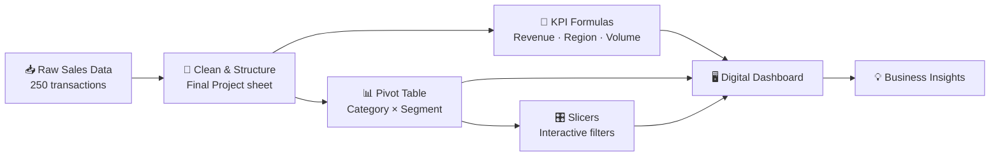

[README (18).md](https://github.com/user-attachments/files/34521032/README.18.md)

### 🔗 [**Open the Project File on Google Drive**](https://drive.google.com/file/d/16KRGdgX6Nz82Qp__NCi_0DGSBsJbrwm9/view?usp=sharing)

https://drive.google.com/file/d/16KRGdgX6Nz82Qp__NCi_0DGSBsJbrwm9/view?usp=sharing

---

# 📊 DIGITAL DASHBOARD

**An interactive Excel sales dashboard that turns 250 raw transactions into clear, decision-ready insights.**

---

## 📑 Table of Contents

1. [Project Overview](#-project-overview)
2. [Problem Statement](#-problem-statement)
3. [Objectives](#-objectives)
4. [Technologies Used](#-technologies-used)
5. [Program Flow](#-program-flow)
6. [Dashboard Output](#-dashboard-output)
7. [Key Insights](#-key-insights)
8. [Author](#-author)

---

## 🌟 Project Overview

The **Digital Dashboard** analyses retail sales data covering **11 April 2024 to 11 April 2025**. Each record holds a transaction, the customer, the product, the payment method, the region and the final amount. The workbook summarises this data with KPI cards, a pivot table with slicers, and charts, so a reader can understand business performance at a glance.

| 📦 Transactions | 👥 Customers | 💰 Total Revenue | 🧮 Units Sold | 🧾 Avg. Order Value |
|:---:|:---:|:---:|:---:|:---:|
| **250** | **50** | **229,192.47** | **753** | **916.77** |

---

## ❗ Problem Statement

Raw transaction data is long, repetitive and hard to read. The dataset has **14 columns and 250 rows**, and the transaction-level view below swings between about 60 and 900 from one row to the next. Reading it line by line, it is hard to see which customer segment, product category, region or payment method actually drives revenue.

*Transaction-wise Total_Amount: the raw view is too noisy to support decisions.*

**The business needs a single dashboard that answers:**

- 💡 How much revenue are we making, and how many units are we selling?
- 💡 Which **customer segment** spends the most?
- 💡 Which **product category** and **region** perform best?
- 💡 How does revenue change over time?

---

## 🎯 Objectives

- ✅ **Clean and structure** the raw sales data into a single, consistent table.
- ✅ **Calculate headline KPIs**: Total Revenue, Top Performing Region and Gross Product Volume.
- ✅ **Summarise** revenue by *Category × Customer Segment* with a **Pivot Table** and **Slicers**.
- ✅ **Visualise** the results with charts that are easy to read.
- ✅ **Support decisions** on marketing, stock and regional focus.

| Revenue by Customer Segment | Revenue by Category |
|:---:|:---:|
|  |  |

---

## 🛠️ Technologies Used

| Technology | Purpose |
|---|---|
|  | Data storage, cleaning and the dashboard sheet |
| **Excel Table** (`Table_1`) | A structured table for the 250 transaction records |
| **Pivot Table** | Total_Amount summed by Category (rows) and Customer Segment (columns) |
| **Slicers** | Click-to-filter controls for the pivot table |
| **Formulas** (`SUM`, `INDEX`, `MATCH`, `COUNTIF`, array formula) | KPI cards on the dashboard |
| **Charts** | Bar, donut and line charts of the output |
| **Python (pandas, matplotlib)** | Used to generate the region, payment-method and monthly-trend charts |

---

## 🔄 Program Flow

**Workbook structure**

| Sheet | Role |
|---|---|
| `Final Project` | Cleaned transaction data (Transaction_ID, Date, Customer, Product, Category, Quantity, Unit_Price, Payment_Method, Region, Customer_Segment, Customer_Since, Total_Amount) |
| `Pivot Table 1` | Pivot summary of Total_Amount by Category and Customer Segment, with slicers |
| `DashBoard` | KPI cards: **Total Revenue**, **Top Performing Region**, **Gross Product Volume** |

**Extra views built from the same data**

| Revenue by Region | Revenue by Payment Method | Monthly Revenue Trend |
|:---:|:---:|:---:|
|  |  |  |

---

## 🖼️ Dashboard Output

| # | Chart | What it shows |
|:-:|---|---|
| 1 |  | Premium and Standard customers generate far more than Basic |
| 2 |  | Electronics is about three-quarters of all revenue |
| 3 |  | Transaction-level amounts, showing the volatility of the raw data |
| 4 |  | East leads, South trails |
| 5 |  | Revenue is spread almost evenly across the four payment methods |
| 6 |  | Month-by-month revenue; Apr 2025 is partial (data ends 11 Apr) |

---

## 🔍 Key Insights

- 🏆 **Electronics** drives **74.9%** of revenue, **Furniture** adds **21.4%** and **Appliances** only **3.6%**.
- 💎 **Premium** customers lead on revenue (~84.7K), closely followed by **Standard** (~82.4K), and **Basic** trails (~62.2K).
- 🌍 **East** is the top region by revenue (~59.3K), while **South** is the lowest (~36.4K).
- 💳 **Credit Card** is the most used payment method (26.8%), but all four methods sit between 22% and 27%.
- 📈 **Laptops** and **Smartphones** are the best-selling products, at roughly 67K each.
- 📅 **January 2025** was the best month (~25.8K).

---

## 👤 Author

### **Tirth**

*Digital Dashboard · Data Analysis Project*

📁 **Project file:** [Google Drive](https://drive.google.com/file/d/16KRGdgX6Nz82Qp__NCi_0DGSBsJbrwm9/view?usp=sharing)

---

⭐ *If you found this project useful, please give it a star!* ⭐

